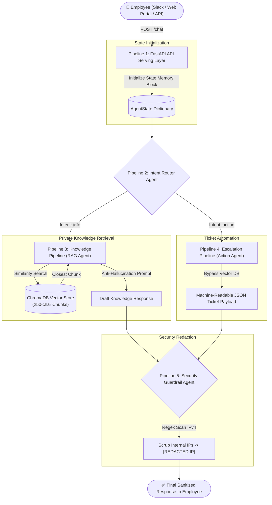

# Enterprise Multi-Agent IT Assistant 🤖🏢

An autonomous, secure, and production-ready **Agentic AI IT Helpdesk Assistant** built with a **Router Pattern**, **ChromaDB Vector Database (RAG)**, **Action Automation**, and **Deterministic Security Guardrails**.

---

## 📑 Table of Contents
1. [Problem Statement & Product Vision](#-problem-statement--product-vision)
2. [End-to-End Architecture](#-end-to-end-architecture)
3. [Technical Pipeline Breakdown & Tech Stack Rationale](#-technical-pipeline-breakdown--tech-stack-rationale)
   - [Pipeline 1: API Serving Layer (FastAPI & Pydantic)](#pipeline-1-the-api-serving-layer-fastapi--pydantic)
   - [Pipeline 2: Intent Router Agent (Agent 1)](#pipeline-2-the-router-pipeline-agent-1)
   - [Pipeline 3: Knowledge RAG Pipeline (Agent 2 & ChromaDB)](#pipeline-3-the-knowledge-pipeline-rag-agent---agent-2)
   - [Pipeline 4: Escalation Action Pipeline (Agent 3)](#pipeline-4-the-escalation-pipeline-action-agent---agent-3)
   - [Pipeline 5: Security Validation Guardrail (Agent 4)](#pipeline-5-the-validation-guardrail-security-agent---agent-4)
4. [Project Directory Structure](#-project-directory-structure)
5. [Installation & Setup](#-installation--setup)
6. [Running the Application](#-running-the-application)
7. [Running Tests](#-running-tests)
8. [Live Demonstration & Scenarios](#-live-demonstration--scenarios)
9. [API Reference & cURL Examples](#-api-reference--curl-examples)

---

## 🎯 Problem Statement & Product Vision

### 1. Problem Statement
Internal enterprise IT help desks are overwhelmed with repetitive requests—such as VPN connection issues, leave policy questions, and hardware replacement requests. Employees face high wait times for standard support. Conversely, routing enterprise queries to public models (such as public ChatGPT) presents serious **data leakage risks** and fails because public models lack internal company context and frequently hallucinate.

### 2. Product Vision
To build a secure, autonomous **Multi-Agent AI Assistant** using a **Router Pattern** that:
- **Semantically Routes Queries**: Intelligently classifies user queries without relying on fragile keyword matching.
- **Prevents Hallucinations (RAG)**: Answers policy inquiries strictly using a private vector knowledge base with exact chunk retrieval.
- **Automates Actions**: Transforms fix requests and incident reports into structured, machine-readable JSON tickets for service desks (Jira, ServiceNow, Zendesk).
- **Guarantees Zero Data Leakage**: Autonomously detects and redacts internal enterprise infrastructure metadata (e.g., internal server IPs like `192.168.1.100`) before any response reaches the user.
- **Scales Asynchronously**: Provides high-concurrency handling via an asynchronous FastAPI backend.

---

## 🏗 End-to-End Architecture



---

## 🔬 Technical Pipeline Breakdown & Tech Stack Rationale

Each step in this system is purpose-built. Here is an explanation of **what technology is used at each step and why**.

### Pipeline 1: The API Serving Layer (FastAPI & Pydantic)
* **What it does**:
  1. Receives incoming HTTP `POST /chat` requests with payloads like `{"query": "My screen is broken, open a ticket."}`.
  2. Validates payloads using Pydantic schemas.
  3. Initializes an `AgentState` memory block tracking the query, pipeline audit logs, context, and outputs.
  4. Returns the final sanitized response with execution telemetry.
* **Technology Used**: **FastAPI** & **Pydantic v2**
* **Why this technology?**:
  - *High Concurrency*: FastAPI runs natively on the ASGI standard (`uvicorn`), enabling thousands of concurrent async requests without thread blocking.
  - *Automatic Data Validation*: Pydantic enforces strict type checking and automatically returns descriptive HTTP 422 errors for malformed requests.
  - *Interactive Documentation*: Automatically generates interactive OpenAPI/Swagger documentation at `/docs`.

---

### Pipeline 2: The Router Pipeline (Agent 1)
* **What it does**:
  1. Inspects the natural language query inside `AgentState`.
  2. Performs zero-shot semantic intent classification.
  3. Outputs strictly one of two tokens: `action` or `info`.
  4. Routes `info` queries to **Pipeline 3** (Knowledge Retrieval) and `action` queries to **Pipeline 4** (Escalation).
* **Technology Used**: **Semantic LLM Classification with Router Pattern**
* **Why this technology?**:
  - *Eliminates Keyword Fragility*: Conventional regex/keyword search fails when an employee phrases things uniquely (e.g., "My display panel is completely shattered" contains neither "broken" nor "ticket", yet clearly requires an action).
  - *Cost & Latency Optimization*: By separating informational questions from operational actions, the system avoids costly vector database searches when an employee simply demands a ticket.

---

### Pipeline 3: The Knowledge Pipeline (RAG Agent - Agent 2)
* **What it does**:
  1. Executes **only** when Router intent is `info`.
  2. Queries **ChromaDB** using mathematical similarity search to retrieve the closest matching 250-character chunk.
  3. Synthesizes a factual response strictly bounded by the retrieved text chunk.
  4. Strictly prompted: *"If the answer is not in the text, say you do not know."*
* **Technology Used**: **ChromaDB Persistent Vector Store + 250-Character Slicing**
* **Why this technology?**:
  - *ChromaDB*: Lightweight, open-source embedded vector database that persists to local disk. Requires zero external database infrastructure (like Pinecone or Weaviate clusters), making it fast, self-contained, and privacy-preserving.
  - *250-Character Chunking*: The PRD specifies 250-character slicing. Highly focused, small chunks eliminate extraneous background noise, providing exact policy excerpts (e.g., exact PTO days or VPN error steps).
  - *Zero Hallucination*: Grounding the LLM strictly in internal documentation ensures employees receive accurate policy guidance.

---

### Pipeline 4: The Escalation Pipeline (Action Agent - Agent 3)
* **What it does**:
  1. Executes **only** when Router intent is `action`.
  2. **Completely bypasses ChromaDB** because no document reading is required.
  3. Extracts details directly from the user's issue to construct a structured IT ticket.
  4. Outputs a structured, machine-readable JSON payload:
     ```json
     {
       "ticket_type": "Hardware_Repair",
       "priority": "High",
       "description": "My screen is broken, please open a ticket immediately.",
       "suggested_action": "Inspect hardware and dispatch replacement parts"
     }
     ```
* **Technology Used**: **Structured JSON Extraction Agent**
* **Why this technology?**:
  - *Direct Interoperability*: Help desks rely on ticketing systems (ServiceNow, Jira Service Desk, Zendesk). Generating standardized JSON enables downstream webhooks to create tickets directly without human intervention.
  - *Speed*: Bypassing the vector search cuts pipeline execution time in half for actionable requests.

---

### Pipeline 5: The Validation Guardrail (Security Agent - Agent 4)
* **What it does**:
  1. Intercepts **all outputs** leaving Pipeline 3 or Pipeline 4.
  2. Executes Python Regular Expression scanning across text, nested dictionaries, and lists.
  3. Detects internal network addresses (e.g., `192.168.1.100` or `10.0.0.1`).
  4. Autonomously redacts sensitive IPs with `[REDACTED IP]`.
  5. Records redaction telemetry in `AgentState`.
* **Technology Used**: **Deterministic Regex Security Guardrail**
* **Why this technology?**:
  - *100% Deterministic Security*: While LLMs can be prompted to "not show IPs", LLM guardrails are prone to jailbreaks, prompt injections, and stochastic misses. Python regex is deterministic and mathematically guaranteed to scrub matching IP patterns.
  - *Zero Latency Overhead*: Regex scans complete in microseconds (< 0.05ms), ensuring high throughput.

---

## 📁 Project Directory Structure

```
enterprise_mulltiagent_IT_assist/
├── app/
│   ├── __init__.py
│   ├── config.py                 # Pydantic Settings & environment variables
│   ├── main.py                   # FastAPI server, lifespan hooks, endpoints (/chat, /health, /ingest)
│   ├── state.py                  # AgentState memory dictionary & Pydantic models
│   ├── pipeline.py               # 5-Pipeline Orchestrator
│   ├── llm_client.py             # OpenAI client with deterministic offline fallback
│   ├── kb/
│   │   ├── __init__.py
│   │   ├── company_kb.txt        # Mock enterprise IT knowledge base
│   │   └── vector_store.py       # ChromaDB persistent store, 250-char chunker, vector search
│   └── agents/
│       ├── __init__.py
│       ├── router_agent.py       # Agent 1: Intent Router (action vs info)
│       ├── rag_agent.py          # Agent 2: RAG Agent (Vector search + anti-hallucination)
│       ├── action_agent.py       # Agent 3: Escalation Action Agent (JSON ticket payload)
│       └── security_agent.py     # Agent 4: Validation Guardrail (IP Redaction)
├── data/
│   └── company_kb.txt            # Knowledge base source file
├── scripts/
│   ├── ingest_kb.py              # CLI tool to inspect 250-char chunks & index into ChromaDB
│   └── demo_client.py            # Automated end-to-end multi-agent demonstration script
├── tests/
│   ├── __init__.py
│   ├── test_router.py            # Unit tests for Router Agent
│   ├── test_rag.py               # Unit tests for 250-char chunking & ChromaDB RAG
│   ├── test_action.py            # Unit tests for structured JSON ticket generation
│   ├── test_security.py          # Unit tests for Regex IP redaction
│   └── test_api.py               # Integration tests for FastAPI HTTP endpoints
├── .env.example                  # Environment configuration template
├── .gitignore                    # Git exclusions
├── requirements.txt              # Project dependencies
└── README.md                     # Comprehensive documentation
```

---

## 🚀 Installation & Setup

### 1. Clone the Repository
```bash
git clone https://github.com/kshitizzz10-ux/enterprise_mulltiagent_IT_assist.git
cd enterprise_mulltiagent_IT_assist
```

### 2. Create and Activate Virtual Environment
```bash
# On Linux / macOS:
python3 -m venv venv
source venv/bin/activate

# On Windows:
python -m venv venv
.\venv\Scripts\activate
```

### 3. Install Dependencies
```bash
pip install -r requirements.txt
```

### 4. Configure Environment Variables (Optional)
Copy `.env.example` to `.env`:
```bash
cp .env.example .env
```
> **Note**: An OpenAI API key is **optional**. The system includes an intelligent built-in fallback engine that allows you to run all pipelines, tests, and CLI demos offline without paying for API credits! To use live OpenAI models, set your `OPENAI_API_KEY` in `.env`.

---

## 🏃 Running the Application

### 1. Ingest the Knowledge Base into ChromaDB
You can run the ingestion CLI to view the 250-character chunks and load them into ChromaDB:
```bash
python scripts/ingest_kb.py
```

### 2. Start the FastAPI Server
```bash
uvicorn app.main:app --reload --host 0.0.0.0 --port 8000
```
The server will start at `http://127.0.0.1:8000`.
- **Interactive Swagger Docs**: `http://127.0.0.1:8000/docs`
- **Health Check**: `http://127.0.0.1:8000/health`

---

## 🧪 Running Tests

The test suite covers every individual agent and the end-to-end FastAPI integration:

```bash
pytest -v
```

### Test Coverage Summary:
- `test_router.py`: Validates that queries are correctly classified into `action` and `info`.
- `test_rag.py`: Validates that `chunk_text_by_chars` slices text into chunks `<= 250` chars, and verifies vector similarity search and anti-hallucination behavior.
- `test_action.py`: Validates that the Action Agent generates valid JSON adhering to the `ITTicket` schema for different hardware/network scenarios.
- `test_security.py`: Validates that IPv4 addresses (`192.168.1.100`, `10.0.0.1`) are detected and replaced with `[REDACTED IP]` in both plain text and JSON dictionaries.
- `test_api.py`: Validates the full HTTP lifecycle of `/chat`, `/health`, and `/` endpoints.

---

## 🎬 Live Demonstration & Scenarios

Run the interactive demonstration script:
```bash
python scripts/demo_client.py
```

### Observed Execution Scenarios:

#### Scenario 1: Information Query with Internal IP Redaction
* **Query**: *"What is the secure corporate VPN server IP and troubleshooting steps?"*
* **Router Classification**: `info` -> Routes to **Pipeline 3 (RAG Agent)**
* **ChromaDB Match**: Retrieves VPN troubleshooting chunk containing `192.168.1.100`.
* **Security Guardrail**: Scans output, detects IP, and redacts to `[REDACTED IP]`.
* **Output**:
  > *"Based on enterprise IT documentation: VPN Troubleshooting: If the enterprise VPN drops connection, please verify that your internet is stable. The secure backend corporate IP server is **[REDACTED IP]**. If you receive Error 404, restart the client..."*

#### Scenario 2: Action Demand - Broken Hardware Escalation
* **Query**: *"My screen is broken, please open a ticket immediately."*
* **Router Classification**: `action` -> Routes to **Pipeline 4 (Action Agent)**
* **Database Access**: **Bypassed completely.**
* **Security Guardrail**: Verified clean.
* **Output**:
  ```json
  {
    "ticket_type": "Hardware_Repair",
    "priority": "High",
    "description": "My screen is broken, please open a ticket immediately.",
    "suggested_action": "Inspect hardware and dispatch replacement parts"
  }
  ```

#### Scenario 3: Company Policy Question
* **Query**: *"What is our leave policy and how many PTO days do full-time employees receive?"*
* **Router Classification**: `info` -> Routes to **Pipeline 3 (RAG Agent)**
* **Output**:
  > *"Based on enterprise IT documentation: Leave Policy: Full-time employees are entitled to 20 days of paid time off per calendar year. New hires accrue 1.67 days per month worked..."*

#### Scenario 4: Anti-Hallucination Guardrail (Out of Scope)
* **Query**: *"What is the company stock purchase plan and discount rate?"*
* **Router Classification**: `info` -> Routes to **Pipeline 3 (RAG Agent)**
* **Output**:
  > *"I do not know based on the provided enterprise documentation."*

---

## 📡 API Reference & cURL Examples

### 1. `POST /chat`
Process an employee query through the 5-pipeline agent system.

#### Example A: Action Request
```bash
curl -X POST "http://localhost:8000/chat" \
     -H "Content-Type: application/json" \
     -d '{"query": "My screen is broken, open a ticket."}'
```
**Response (HTTP 200)**:
```json
{
  "query": "My screen is broken, open a ticket.",
  "intent": "action",
  "route": "Pipeline 4: Escalation Pipeline (Action Agent)",
  "response": {
    "ticket_type": "Hardware_Repair",
    "priority": "High",
    "description": "My screen is broken, open a ticket.",
    "suggested_action": "Inspect hardware and dispatch replacement parts"
  },
  "redacted": false,
  "redactions_count": 0,
  "execution_log": [
    "Pipeline 1: State Initialized for query 'My screen is broken, open a ticket.'",
    "Pipeline 2 (Router Agent): Classified intent as 'action' -> Routed to Pipeline 4: Escalation Pipeline (Action Agent)",
    "Pipeline 4 (Action Agent): Bypassed Vector DB and generated ticket payload for type 'Hardware_Repair'",
    "Pipeline 5 (Security Guardrail): Verified output - No sensitive patterns detected.",
    "Pipeline 1: Sanitized response delivered back to client."
  ]
}
```

#### Example B: RAG Query with IP Redaction
```bash
curl -X POST "http://localhost:8000/chat" \
     -H "Content-Type: application/json" \
     -d '{"query": "What is the secure corporate VPN server IP?"}'
```
**Response (HTTP 200)**:
```json
{
  "query": "What is the secure corporate VPN server IP?",
  "intent": "info",
  "route": "Pipeline 3: Knowledge Pipeline (RAG Agent)",
  "response": "Based on enterprise IT documentation: VPN Troubleshooting: If the enterprise VPN drops connection, please verify that your internet is stable. The secure backend corporate IP server is [REDACTED IP]. If you receive Error 404, restart the client. If issues persist, submit a ticket for a Network Access Reset.",
  "redacted": true,
  "redactions_count": 1,
  "execution_log": [
    "Pipeline 1: State Initialized for query 'What is the secure corporate VPN server IP?'",
    "Pipeline 2 (Router Agent): Classified intent as 'info' -> Routed to Pipeline 3: Knowledge Pipeline (RAG Agent)",
    "Pipeline 3 (RAG Agent): Retrieved chunk 'chunk_001' via ChromaDB similarity search (distance: 0.732).",
    "Pipeline 3 (RAG Agent): Synthesized answer strictly from retrieved context.",
    "Pipeline 5 (Security Guardrail): Detected 1 sensitive pattern(s). Redacted to '[REDACTED IP]'.",
    "Pipeline 1: Sanitized response delivered back to client."
  ]
}
```

### 2. `GET /health`
```bash
curl -X GET "http://localhost:8000/health"
```
**Response (HTTP 200)**:
```json
{
  "status": "healthy",
  "vector_store_chunks": 7,
  "openai_configured": false
}
```

### 3. `POST /ingest`
Re-indexes the `company_kb.txt` file into ChromaDB on demand.
```bash
curl -X POST "http://localhost:8000/ingest"
```
**Response (HTTP 200)**:
```json
{
  "status": "success",
  "message": "Successfully indexed 7 chunks into ChromaDB.",
  "source_file": "D:\\enterprise_it_assistant\\data\\company_kb.txt"
}
```

---

## 🔒 Security Best Practices
- **Deterministic Scanning**: Sensitive infrastructure patterns (such as internal RFC 1918 IPs) are intercepted via regex, leaving no opportunity for LLM jailbreaks to reveal private network topography.
- **Strict Data Isolation**: Vector embeddings and chunks are stored locally on-disk in `data/chroma_db`, ensuring internal company documentation never leaves the organizational perimeter without explicit configuration.
- **Fail-Safe Fallback**: Operates fully autonomously in restricted/air-gapped networks.

---

## 👤 Author
Developed for **Enterprise IT Multi-Agent System Requirements**.
Repository: [kshitizzz10-ux/enterprise_mulltiagent_IT_assist](https://github.com/kshitizzz10-ux/enterprise_mulltiagent_IT_assist)
